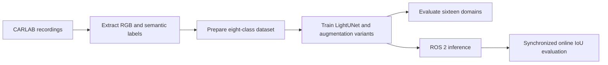

# Semantic Image Segmentation under Domain Shifts

How much do night, rain, a new town and a different camera setup affect semantic segmentation? This ACDC research project studies a compact LightUNet trained on synthetic CARLAB/CARLA driving images and evaluated on **16 domains across five experimental blocks**. The repository includes the report, training and evaluation code, sensor configurations, and ROS 2 inference/evaluation nodes.

**Read without installing:** [research report with saved outputs](report.ipynb) · [results overview](RESULTS.md) · [original task](task.ipynb).

The plot is exported from the saved report output; no experiment was rerun for this presentation update.

## Findings from the archived experiment

| Condition | Baseline mIoU | Observation |
| --- | --- | --- |
| In-distribution domains V1–V3 | 0.6832–0.7491 | ClearNoon reference conditions |
| Night V7 | 0.2333 | Largest single-factor degradation in this study |
| Camera pitch V12 | 0.3411 | Sensitivity to viewpoint |
| Camera height V11 | 0.4768 | Sensitivity to mounting configuration |
| Unseen towns V8–V10 | 0.6422–0.6832 | Smaller degradation than night or camera pitch |

Photometric augmentation raises V7 night mIoU to approximately 0.385; geometric augmentation raises V12 pitch mIoU to approximately 0.478. These are results from this synthetic-data experiment, not real-world driving performance. The report discusses one-run training variance, the chase-view camera and weak pedestrian-class performance.

## Method and code map

| Read or run | Entry |
| --- | --- |
| Full study and saved figures | [report.ipynb](report.ipynb) |
| Model and label mapping | [model.py](model.py), [carla_labels.py](carla_labels.py) |
| Data extraction and preparation | [data_extraction.py](data_extraction.py), [prepare_datasets.py](prepare_datasets.py) |
| Training and evaluation | [train.py](train.py), [evaluation.py](evaluation.py) |
| ROS 2 packages | [ros2_ws/src](ros2_ws/src/) |
| Recorded replay/live artifacts | [report_artifacts](report_artifacts/) |

## Reproduction and data availability

**Browsing the report requires no local dataset. Re-executing the experiment does.** Approximately 18 GB of processed data and 835 MB of checkpoints are not included in this public Git repository. The [data-access guide](DATA_ACCESS.md) documents the original RWTH filesystem paths and regeneration workflow; those paths require institutional access and are not public download links. No public data/checkpoint download is currently provided here.

For the offline pipeline, use the original project environment or a compatible Python environment with [requirements.txt](requirements.txt). The report's setup cell documents the original installation order. ROS is not needed for offline training/evaluation; the ROS section requires the project's ROS 2 Jazzy environment. Installing dependencies alone will not supply recordings or model weights.

For readers without institutional access, start with [RESULTS.md](RESULTS.md), the saved notebook outputs, the source code and recorded ROS artifacts. The notebook remains a historical research report; it is not a one-click public reproduction package.

---

## 中文概览

本研究用 CARLAB/CARLA 合成数据训练 LightUNet，在 16 个域、5 类实验组中分析天气、光照、城市场景和相机配置变化对语义分割的影响，并提供 ROS 2 推理及在线评价节点。

归档结果显示：同分布 mIoU 为 0.6832–0.7491；夜间 V7 降至 0.2333，相机俯仰 V12 降至 0.3411。针对性数据增强可恢复部分精度。数值来源于已保存报告，本次没有重新训练或运行实验，也不代表真实道路验证。

可直接阅读[结果摘要](RESULTS.md)和[研究报告](report.ipynb)。重新执行需要数据与权重，公开仓库不含这些大文件；学校内部路径不是公开下载地址。模型、数据处理、评价和 ROS 2 代码入口见上表。
