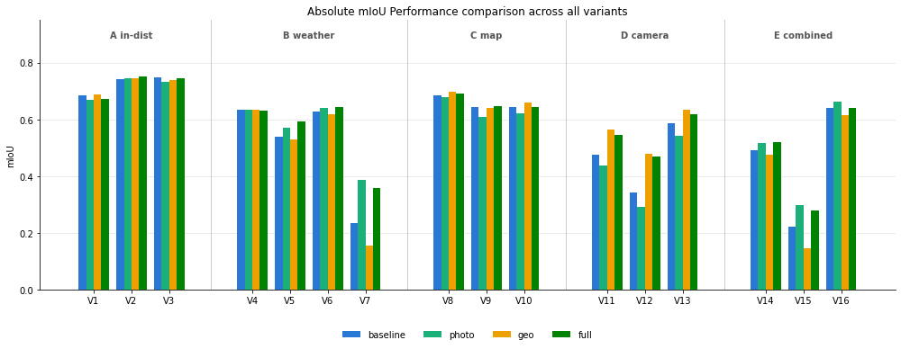
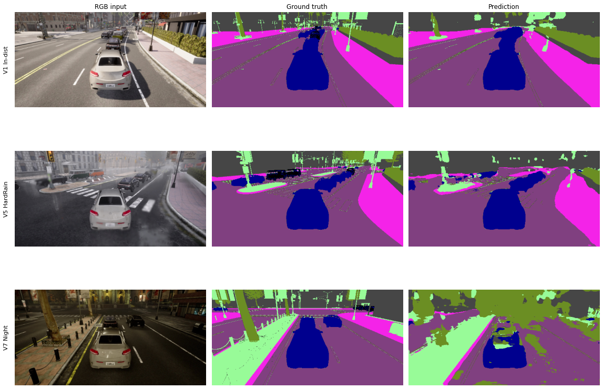

# Archived experiment results

Source: saved outputs and analysis in [report.ipynb](report.ipynb). Figures below are extracted unchanged from that notebook. This page does not report a new run.

## Domain shift and augmentation

The baseline is compared with photometric (`photo`), geometric (`geo`) and combined (`full`) augmentation. A is in-distribution, B weather/lighting, C unseen maps, D camera configuration, and E combined map/weather shifts. Interpret each bar within the report's experimental protocol rather than as a general benchmark ranking.

## Qualitative examples

The archived comparison illustrates reference V1, heavy-rain V5 and night V7 scenes. It complements the aggregate IoU metrics; these are selected examples rather than a complete error analysis.

## ROS 2 verification reported in the notebook

- A ten-pair replay matched an independently computed confusion matrix for the received predictions.
- A recorded live run accumulated 461 evaluated pairs with mIoU 0.6243.
- On ten captured semantic messages, the revised decoder produced identical masks and a 3.93× ratio between old and new median decoding times.

These observations have different scopes: replay metric correctness, live segmentation quality and decoder timing. The 3.93× figure is not end-to-end inference speedup. See the report and [saved artifacts](report_artifacts/) for details.

## Limits

The baseline was trained once without a fixed seed. The reported block-bootstrap uncertainty measures recording variation, not variation across training seeds. The chase-view camera includes the ego vehicle, and pedestrian IoU remained weak. No real-world or sim-to-real validation is established here.

---

## 中文说明

本页提取已有 notebook 的结果图，未重新运行实验。五类实验分别考察同分布、天气光照、地图、相机与组合变化。报告还记录了 10 对回放样本的指标一致性验证、461 对在线评价及解码耗时比较。解码 3.93 倍耗时比不等于端到端推理加速。结论受单次训练、相机视角和行人类别表现等限制。
